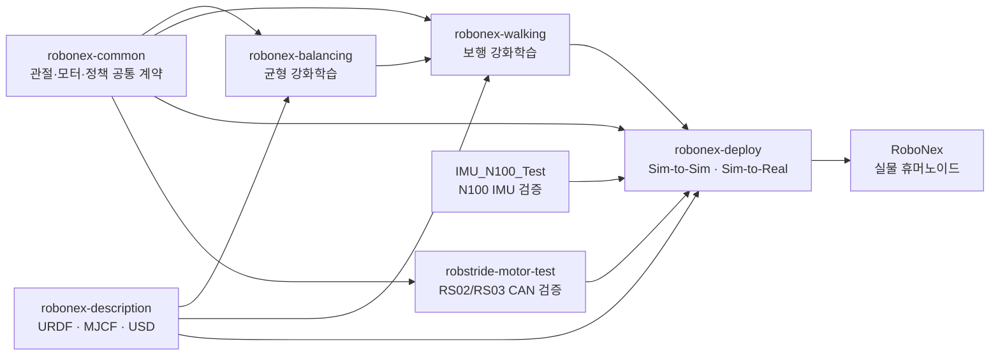

# RoboNex Walking

실행 스크립트의 전체 파라미터 목록은 [scripts/README.md](scripts/README.md)를 참고하세요.

<div align="center">

**폐루프 링크 구조를 가진 12자유도 하체 휴머노이드 RoboNex의 보행 강화학습 프로젝트**

RoboNex의 로봇 모델, 공통 제어 계약, 균형·보행 학습, 모터·IMU 검증, 시뮬레이션 및 실기 배포 과정을 하나의 흐름으로 연결합니다.

[](https://youtu.be/tN_TbdNKPEo?si=ME0WL47wWYq7zZJ1)


</div>

## 프로젝트 개요

RoboNex는 무릎의 4절 링크와 두 모터가 결합된 차동 발목을 포함하는 하체 휴머노이드입니다. 단순한 직렬 관절 모델이 아니라 실제 기구의 폐루프 구조와 모터 공간을 반영한 모델을 사용하고, Isaac Lab에서 학습한 정책을 MuJoCo와 실제 CAN 모터 환경까지 연결하는 것을 목표로 합니다.

이 저장소는 전체 RoboNex 프로젝트 가운데 **평지 보행 정책**(전진·후진·횡이동·제자리 회전·정지)을 담당합니다. 관련 기능은 여러 저장소로 분리되어 있지만, 대회 제출본인 이 README만으로도 전체 구성과 각 저장소의 역할을 파악할 수 있도록 정리했습니다.

| 구분 | 현재 설계 |
| --- | --- |
| 로봇 | 12개 구동 관절을 가진 RoboNex 하체 휴머노이드 |
| 핵심 기구 | 폐루프 무릎 4절 링크, 2모터 차동 발목 |
| 학습 환경 | NVIDIA Isaac Sim / Isaac Lab |
| 강화학습 | RSL-RL PPO |
| Gym Task | `RoboNex-Walking-V2-Edu-v0` (Pro·Max: `-V2-Pro-v0`, `-V2-Max-v0`) |
| 로봇 모델 | `robonex-description` ver2-3 Edu (폐루프 mesh USD) |
| 목표 동작 | 평지에서 속도 명령 추종: `vₓ -0.2–0.5 m/s`, `vᵧ ±0.2 m/s`, `ω_z ±0.2 rad/s`, 정지 |
| 물리·정책 주기 | 물리 `400 Hz`, 정책 `50 Hz` |
| 정책 입출력 | 관측 `47-D × 5` 프레임 = `235-D`, 행동 `12-D` |
| 병렬 환경 | `4096` environments (코드 기본값 `512`, 학습 실행 시 지정) |
| 에피소드 | 최대 `20 s` |
| 실기 배포 | Jetson Orin, RS02/RS03 CAN, 정책 `50 Hz` |

## 전체 개발 구조



`robonex-common`이 관절 순서, 모터 파라미터, 관절 제한 및 정책 인터페이스를 고정하고, `robonex-description`이 동일한 로봇을 여러 시뮬레이터 형식으로 제공합니다. 본 저장소에서 학습한 정책은 `robonex-deploy`를 통해 MuJoCo 검증과 실제 하드웨어 적용 단계로 이어집니다.

## 연계 저장소

<div align="center">

[](https://github.com/Humanoid-Project/robonex-common)
[](https://github.com/Humanoid-Project/robonex-description)
[](https://github.com/Humanoid-Project/robonex-balancing)
[](https://github.com/Humanoid-Project/robonex-walking)
[](https://github.com/Humanoid-Project/robonex-deploy)
[](https://github.com/Humanoid-Project/robstride-motor-test)
[](https://github.com/Humanoid-Project/IMU_N100_Test)

</div>

| 저장소 | 역할 | 본 프로젝트와의 연결 |
| --- | --- | --- |
| `robonex-common` | 관절 ID·순서·제한, RS02/RS03 사양, CAN 및 정책 계약 | 보행 정책의 12개 관절 순서와 행동 정규화 공유 |
| `robonex-description` | URDF, MJCF, USD 로봇 모델 | Isaac Lab의 폐루프 mesh USD 제공 |
| `robonex-balancing` | 정적 균형 PPO 학습 | 관측·행동 계약과 안정화 설계를 보행 과제로 확장 |
| `robonex-walking` | 평지 보행 PPO 학습 | 대회 제출 및 현재 저장소 |
| `robonex-deploy` | Isaac–MuJoCo–실물 로봇 연결 | 정책 manifest 검증과 Sim-to-Sim/Sim-to-Real 담당 |
| `robstride-motor-test` | RobStride RS02/RS03 CAN 측정·제어 | 모터 ID, 물리 특성 및 실제 관절 동작 검증 |
| `IMU_N100_Test` | WHEELTEC N100 C++/ROS 2 SDK | 실제 정책 관측에 필요한 각속도·자세 정보 제공 |

## 보행 강화학습 설계

### 정책 인터페이스

정책은 속도 명령 `(vₓ, vᵧ, ω_z)`와 보행 주기 위상을 관측으로 받아, 하나의 정책으로 전진·후진·횡이동·제자리 회전·정지를 수행합니다. 한 프레임은 47차원이며 최근 5프레임을 이어 붙인 235차원 벡터가 정책 입력입니다. 아래 값은 실기에 배포한 정책의 학습 설정(`params/env.yaml`, `policy_manifest.json`)을 기준으로 합니다.

| 관측 항목 | 프레임당 차원 | 내용 |
| --- | ---: | --- |
| 관절 상대 위치 | 12 | 12개 구동 관절의 기준 자세 대비 위치 |
| 관절 상대 속도 | 12 | 12개 구동 관절의 속도 |
| IMU 각속도 | 3 | 몸체 좌표계의 각속도 |
| 투영 중력 벡터 | 3 | 몸체 기울기를 나타내는 중력 방향 |
| 속도 명령 | 3 | 목표 `vₓ`, `vᵧ`, `ω_z` |
| 보행 위상 | 2 | 주기 `0.8 s` 보행 시계의 `sin`, `cos` |
| 이전 행동 | 12 | 직전 정책 출력 |
| **프레임 합계** | **47** | × 5프레임 = **235** |

정책은 12개 모터 공간 관절의 위치 목표를 출력합니다. 원시 행동은 관절별 offset과 scale을 거쳐 물리 목표로 변환되고, 관절별 안전 범위와 발목 두 모터의 결합 roll 제한(`12°`)으로 다시 제한됩니다. 학습과 배포 모두 목표 변화에 속도 `6 rad/s`·가속도 `120 rad/s²` 제한(slew limiter)을 적용합니다.

### 속도 명령

| 항목 | 설정 |
| --- | --- |
| 명령 범위 | `vₓ -0.2–0.5 m/s`, `vᵧ -0.2–0.2 m/s`, `ω_z -0.2–0.2 rad/s` |
| 커리큘럼 | `vₓ = 0.1 m/s`에서 시작해 추종이 충분하면 범위를 단계적으로 넓힘 |
| 재샘플링 | `10 s`마다, 환경의 `15 %`는 정지 명령 |

### 보상함수 구조

전체 보상은 설정된 항목의 가중합으로 구성됩니다.

`R = Σᵢ wᵢ rᵢ`

추종 항목은 `exp(-오차² / σ²)` 형태의 양의 보상이고, 벌점 항목은 오차의 제곱을 상한으로 자른 뒤 대부분 `1 - exp(-q / s)`로 `[0, 1)` 구간에 포화시켜 비정상 상태가 학습 전체의 수치 발산으로 이어지지 않도록 했습니다.

| 분류 | 항목 · 가중치 | 내용 |
| --- | --- | --- |
| 생존 | `alive` · `+0.5`, `terminating` · `-5.0` | 넘어지지 않고 동작을 지속, 낙상·불안정 종료 억제 |
| 속도 추종 | `track_lin_vel_x` · `+3.0` | yaw 정렬 좌표계 전진 속도 추종, `σ = 0.15` |
| | `track_lin_vel_y_cycle` · `+1.0`, `lin_vel_y` · `-0.3` | 횡속도 추종(`40` step 보행 주기 평균, `σ = 0.15`)과 명령 대비 횡속도 오차 억제 |
| | `track_ang_vel_z` · `+1.0` | yaw 각속도 추종, `σ = 0.5` |
| 보행 패턴 | `feet_gait` · `+1.0` | 주기 `0.8 s`, 좌우 위상차 `0.5`의 보행 시계와 접촉 패턴 일치 |
| | `feet_clearance` · `-0.5` | 스윙 구간에서 발바닥 높이 `0.053 m` 추종 |
| | `feet_width` · `-0.3` | 양발 폭 `0.269 m`(정지 시 `0.303 m`) 유지 |
| | `flight_phase` · `-0.2`, `foot_slip` · `-0.3` | 두 발 동시 이탈과 접촉 발 미끄러짐 억제 |
| | `feet_contact_force` · `-1.0` | 평균 접지력 `373.9 N` 초과분 억제(착지 충격) |
| 정지 | `stand_still` · `-2.0`, `stand_still_pose` · `-1.0` | 정지 명령에서 양발 지지와 기준 자세 유지 |
| | `stand_hip_roll_load` · `-0.2` | 정지 중 hip roll 토크 부하 억제(발열 대응) |
| 자세 | `flat_orientation` · `-1.0`, `base_height` · `-0.3` | roll·pitch 기울기 억제, 몸체 높이 `0.942 m` 유지 |
| | `lin_vel_z` · `-0.1`, `ang_vel_xy` · `-0.1` | 상하 진동과 roll·pitch 흔들림 억제 |
| | `com_forward_margin` · `-0.5` | 무게중심이 양발 중심보다 `0.055 m` 앞에 오도록 유도(뒤로 넘어짐 방지) |
| | `joint_deviation_yaw_roll` · `-0.2` | hip yaw·roll 관절의 기준 자세 이탈 억제 |
| 구동 효율·안전 | `torque_overrun` · `-0.05` | 속도별 모터 연속 정격을 넘는 토크 억제 |
| | `energy` · `-0.05`, `joint_vel` · `-0.1`, `joint_acc` · `-0.05` | 기계적 일률, 관절 속도·가속도 억제 |
| | `action_rate` · `-0.2`, `action_smoothness` · `-1.0` | 행동 변화와 물리 목표 변화 억제(후자는 학습 초기에 점진 적용) |
| | `joint_pos_limits` · `-5.0`, `target_clip_excess` · `-0.3`, `foot_roll_clip_excess` · `-1.0` | 관절 한계 접근, 목표 제한·발목 결합 roll 제한 초과 억제 |

### 도메인 랜덤화

| 대상 | 범위 | 목적 |
| --- | --- | --- |
| 초기 yaw | `-π–π rad` | 월드 방향과 무관한 정책 학습 |
| 초기 몸체 속도 | 평면·회전축별 `-0.2–0.2` | 초기 상태 변화 대응 |
| 외란 속도 | 보행 중 `10–15 s`, 정지 중 `4–8 s`마다 x/y `-0.5–0.5 m/s` | 외란 회복 유도 |
| 접촉 마찰 | 정지·동마찰 `0.3–1.0` | 지면 조건 변화 대응 |
| 관절 마찰 | hip pitch·roll·knee `0.2–0.8 N·m`, hip yaw·발목 `0.05–0.25 N·m` | 실측 구동부 마찰 반영 |
| hip yaw 강성 | 기준값의 `0.25–1.0`배 | yaw 축 제어 오차 대응 |
| base mass | 기준값에 `-0.3–0.3 kg` 추가 | 질량 오차 대응 |
| base 무게중심 | x `-0.03–0.0 m` | 무게중심 추정 오차 대응 |
| IMU 지연 | 물리 `1–6` step (`2.5–15 ms`) | 실기 센서 지연 반영 |
| 센서 관측 | 관절·IMU·중력 항목별 노이즈, IMU 각속도 bias | Sim-to-Real 관측 편차 완화 |

### 종료 조건

| 조건 | 기준 | 목적 |
| --- | --- | --- |
| 시간 제한 | `20 s` | 고정 길이 에피소드 구성 |
| 낙상 | base 높이 `< 0.528 m` | 회복 불가능한 자세 조기 종료 |
| 비정상 접촉 | 몸체·hip·knee·ankle 링크의 접촉력 `> 1 N` | 발 이외 부위의 지면 접촉 차단 |
| 관절 불안정 | 관절 속도 절댓값 `> 100 rad/s`, 비유한 상태·접촉력 | 폐루프 기구의 비정상 상태 차단 |

## 학습 구성

| 항목 | 설정 |
| --- | --- |
| 알고리즘 | PPO (`SmoothPPO`: 좌우 대칭 데이터 증강, 정책 손실에 `12.5–25 Hz` 각속도 응답 억제 항) |
| Actor/Critic | `[256, 128, 128]`, ELU, 관측 정규화 |
| 초기 action noise | `1.0` |
| Rollout | 환경당 `24` steps, `4096` environments |
| 학습 반복 | 배포 정책 `1000` iterations |
| Discount / GAE | `γ = 0.99`, `λ = 0.95` |
| Learning rate | `1.0×10⁻³`, adaptive schedule (`KL 0.01`) |
| PPO clip | `0.2` |
| Entropy coefficient | `0.008` |

## 현재 구현 상태

| 구분 | 상태 |
| --- | --- |
| `RoboNex-Walking-V2-{Edu,Pro,Max}-v0` task 등록 | 구현 완료 |
| 폐루프 RoboNex USD 및 공통 관절 계약 연결 | 구현 완료 |
| 235차원 관측(47 × 5프레임)·12차원 행동, 속도 명령 관측 | 구현 완료 |
| 보행 보상함수, 도메인 랜덤화, 종료 조건 | 구현 완료 |
| Isaac Lab 학습 및 정책 성능 평가 | 완료 (속도 명령별 평가, 외란·마찰·지연 조건) |
| MuJoCo Sim-to-Sim 검증 | 완료 (폐루프 MJCF, slew limiter·지연 포함) |
| 실제 RoboNex Sim-to-Real 적용 | 완료 (Jetson Orin, 2026-10-15) |

실제 로봇에서는 전진(`vₓ` 최대 `0.5 m/s`), 정지, 횡이동, 제자리 회전을 확인했습니다. 50 Hz 제어 주기는 지연 tick 없이 유지되었고 정책 추론은 약 `1–2 ms`입니다. 상단 영상은 RoboNex의 개발 및 하드웨어 시연 자료입니다.

## 저장소 구성

```text
robonex-walking/
├── README.md
├── scripts/
│   ├── list_envs.py
│   ├── zero_agent.py
│   ├── random_agent.py
│   ├── export_policy_manifest.py
│   └── rsl_rl/
│       ├── train.py
│       ├── play.py
│       ├── eval_commands.py
│       ├── sim_joint_trace.py
│       ├── export_actor_cpu.py
│       └── eval/judge.py
├── tests/
└── source/robonex_walking/
    └── robonex_walking/
        ├── algorithms/smooth_ppo.py
        └── tasks/manager_based/robonex_walking/
            ├── agents/
            ├── mdp/
            ├── robot_contract_v2.py
            └── robonex_walking_v2_env_cfg.py
```

---

Developed by [Humanoid-Project](https://github.com/Humanoid-Project).
